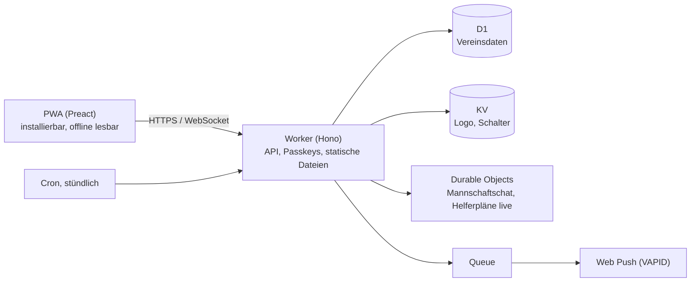

> **Kabine nützlich?** Gib dem Repo einen ⭐, um die Entwicklung zu unterstützen.

**English:** [README in English](README.md)

# Kabine

**Eine Mannschafts-App für Amateursportvereine zum Selbstbetreiben, die komplett auf Cloudflare läuft: kein eigener Server, und im kostenlosen Tarif fallen keine Kosten an.**

Training und Spiele mit Zu- und Absagen, Kader, Mannschaftschat, Push-Benachrichtigungen, Helferdienste und Fahrgemeinschaften, für Spieler, Eltern und Trainer. Jeder Verein richtet mit einem Klick seine eigene Kopie im eigenen Cloudflare-Konto ein.

**Demo ausprobieren, ohne Anmeldung:** [als Spielerin](https://handball.kabine.dev/api/demo/login/player?lang=de) · [als Elternteil](https://handball.kabine.dev/api/demo/login/parent?lang=de) · [als Trainerin](https://handball.kabine.dev/api/demo/login/coach?lang=de) · [als Admin](https://handball.kabine.dev/api/demo/login/admin?lang=de)

[](https://github.com/witscher/kabine/actions/workflows/ci.yml)
[](CHANGELOG.md)
[](LICENSE)
[](https://github.com/witscher/kabine/stargazers)

[](https://deploy.workers.cloudflare.com/?url=https://github.com/witscher/kabine)

<table>
  <tr>
    <td></td>
    <td></td>
    <td></td>
  </tr>
</table>

Entstanden ist sie als App eines Handballvereins, in dem sie mehrere hundert Spieler, Eltern und Trainer jeden Tag nutzen. Demo und Bilder zeigen einen erfundenen Verein; mehr in [docs/screenshots](docs/screenshots/de).

## Schnellstart

```sh
git clone https://github.com/witscher/kabine && cd kabine
npm ci                              # Node.js 22 oder neuer
npm run secrets:generate -- --dev   # lokale Geheimnisse in .dev.vars
npm run db:reset:local              # lokale Datenbank mit dem erfundenen Demo-Verein
npm run dev                         # http://localhost:5173
```

Der erste Admin wird unter `/einrichtung#<ADMIN_BOOTSTRAP_TOKEN>` eingerichtet (siehe `.dev.vars`). `npm run check` führt Typprüfung und alle Tests aus, `npm run e2e` die Playwright-Tests.

Für einen Verein nimmst du den Deploy-Knopf oben: Er legt die Kopie und alle Ressourcen an, und der kostenlose Tarif reicht für einen üblichen Verein. Schritt für Schritt: [docs/install.md](docs/install.md); Betrieb (Sicherung, Saisonwechsel, Updates): [docs/operation.md](docs/operation.md).

## Unter der Haube



- **Durchgehend serverlos:** Workers mit statischen Dateien, D1, KV, Durable Objects, Queues und Cron Triggers. Kein Container, keine VM, nichts zu patchen.
- **Echtzeit-Chat** auf Durable Objects mit schlafenden WebSockets; Helferpläne aktualisieren sich genauso live.
- **Push ohne Drittanbieter:** Web Push mit VAPID, verschickt aus einer Queue.
- **Keine Passwörter:** Anmeldung per Passkey (WebAuthn), Einladungen per Link, optional Codes per E-Mail oder SMS.
- **Installierbare PWA,** die den zuletzt geladenen Stand auch offline zeigt, auch auf dem iPhone.
- **Sichere Updates für jeden Verein:** Releases kommen als Pull Request in die Kopie des Vereins; Migrationen laufen mit einem Wiederherstellungspunkt von D1 Time Travel und nach dem Muster „erst ergänzen, später entfernen“, jede mit einem Upgrade-Test.
- **Datensparsam gebaut:** von Spielern Vorname, Nachname und Jahrgang, mehr standardmäßig nicht; kein Tracking, keine fremden Skripte oder Schriften.
- **Getestet:** Vitest in der Workers-Laufzeit (mit Vertragstests für jedes Modul und jede Spielplan-Anbindung und einem Test für jede [Sicherheitsregel](docs/dev/security.md)), Playwright-Tests und ein Durchlauf von der leeren Datenbank durch alle Rollen.
- **Mehrsprachig mit Lingui:** Englisch und Deutsch, gettext-`.po`-Dateien, die jeder korrigieren kann.

Gebaut mit TypeScript, [Hono](https://hono.dev), [Preact](https://preactjs.com) und [Lingui](https://lingui.dev). Architektur: [docs/dev/architecture.md](docs/dev/architecture.md); Design und Entscheidungen: [docs/dev/design.md](docs/dev/design.md), [docs/dev/decisions.md](docs/dev/decisions.md).

## Was Vereine bekommen

- **Spieler** sehen ihre Trainings, Spiele und Sondertermine, sagen mit einem Tipp zu oder ab und werden bei Änderungen benachrichtigt. Trainings gelten als zugesagt, bis jemand absagt.
- **Eltern** antworten für ihre Kinder, lesen im Mannschaftschat mit, übernehmen Helferdienste und bieten Plätze für Auswärtsspiele an. Sie entscheiden, was ihr Kind in der App darf.
- **Trainer** legen einmal pro Saison Trainingspläne an (Schulferien werden ausgelassen), nominieren Kader, sagen Trainings mit einer Benachrichtigung ab oder verlegen sie, laden Spieler und Eltern per Link ein und sehen, wer noch nicht erreichbar ist.
- **Admins** richten den Verein mit einem Assistenten ein, übernehmen Mannschaften und Personen aus Excel- oder CSV-Listen und führen einmal im Jahr den Saisonwechsel durch.

Zuschaltbare Module: Helferdienste, Jugendschiedsrichter, Fahrgemeinschaften, Spielpläne von handball4all, Codes und Erinnerungen per SMS.

## Für Vereine und Datenschutzbeauftragte

Eine Installation pro Verein, im eigenen Cloudflare-Konto des Vereins: Es gibt keinen zentralen Server, und die Entwickler von Kabine haben keinen Zugriff auf die Daten eines Vereins. Zugang nur per Einladung, nicht in den App-Stores, gespeichert wird nur, was eine Mannschaft Woche für Woche braucht. Die vollständige Liste der gespeicherten Daten, Löschfristen und eine Vorlage für die Datenschutzerklärung stehen in [docs/privacy.de.md](docs/privacy.de.md); Fragen zu Kosten, DSGVO und „Warum Cloudflare“ beantwortet [kabine.dev](https://kabine.dev/).

## Mitmachen

Das Repository ist für Beiträge mit einem Coding-Agent gebaut (Claude Code, Codex, Cursor, …): Jeder Beitrag ist ein eigener Ordner oder eine eigene Datei, ein Generator legt das Gerüst an, und Vertragstests zeigen sofort, was noch fehlt. Gute Einstiege:

| Hinzufügen | Befehl |
| --- | --- |
| Eine Sportart (Altersklassen, Spielzeiten, übliche Helferdienste) | `npm run new -- sport basketball --name "Basketball"` |
| Spielpläne aus dem System eines Verbands (nuLiga, SAMS, …) | `npm run new -- connector nuliga --vendor "nuLiga" --domain nuliga.example --sport handball` |
| Eine Funktion, die Vereine zuschalten können | `npm run new -- module polls --label "Polls" --label-de "Umfragen"` |
| Eine Sprache oder eine bessere Übersetzung | [docs/dev/translation.md](docs/dev/translation.md) |

Der Einstieg für Menschen und Agents ist [AGENTS.md](AGENTS.md). Ein Mensch schickt den Pull Request, hat ihn lokal ausprobiert und beantwortet Fragen. Ideen und Wünsche: [Issues](https://github.com/witscher/kabine/issues/new/choose); Sicherheitsprobleme: [SECURITY.md](SECURITY.md).

## Lizenz

AGPL-3.0-only, siehe [LICENSE](LICENSE). Du darfst Kabine betreiben, ändern und weitergeben. Wer eine geänderte Fassung für andere betreibt, muss ihnen den Quellcode anbieten.

---

Wenn Kabine dir oder deinem Verein hilft, hilft ein ⭐ anderen, die App zu finden.
