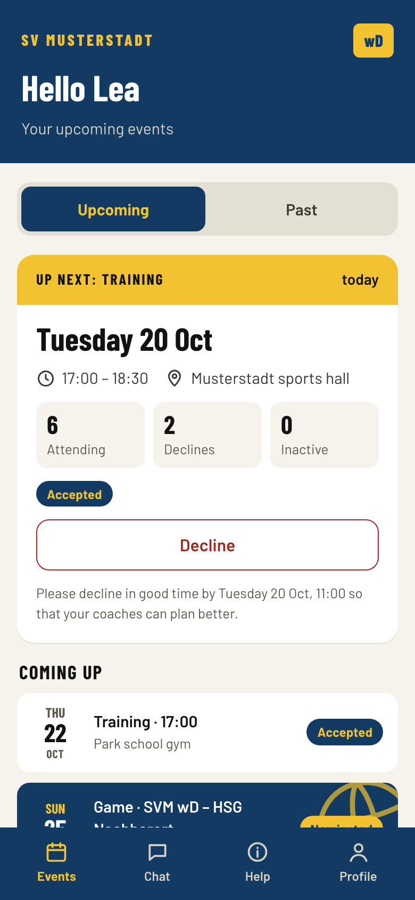
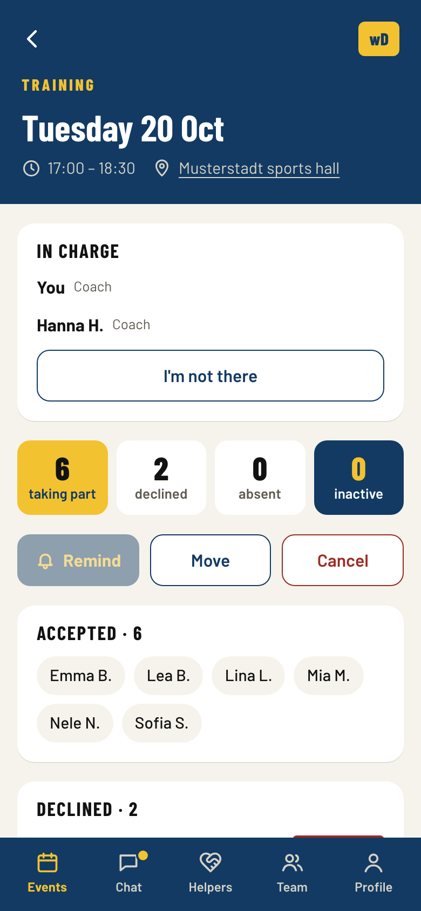
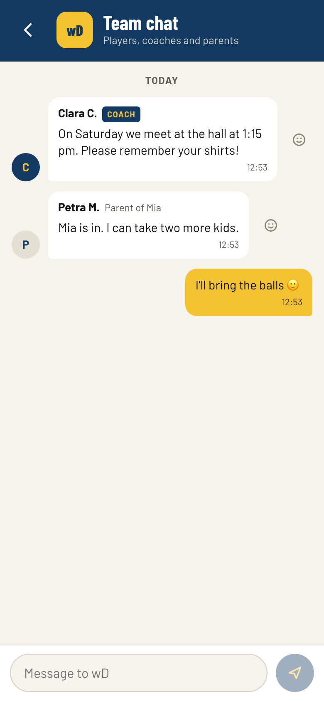
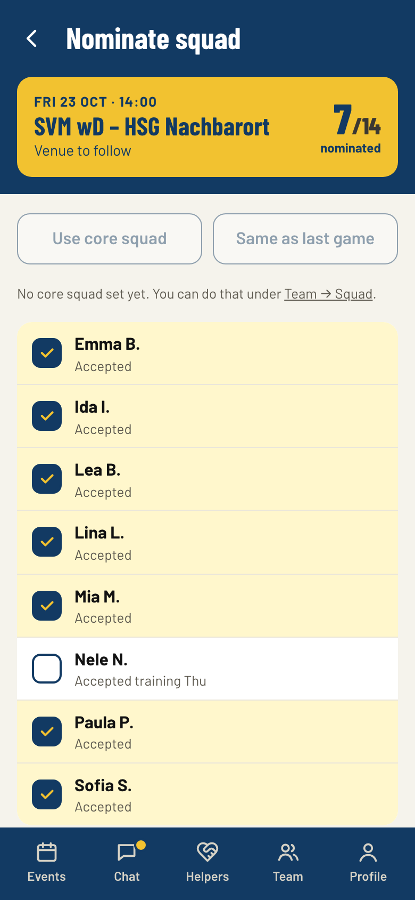
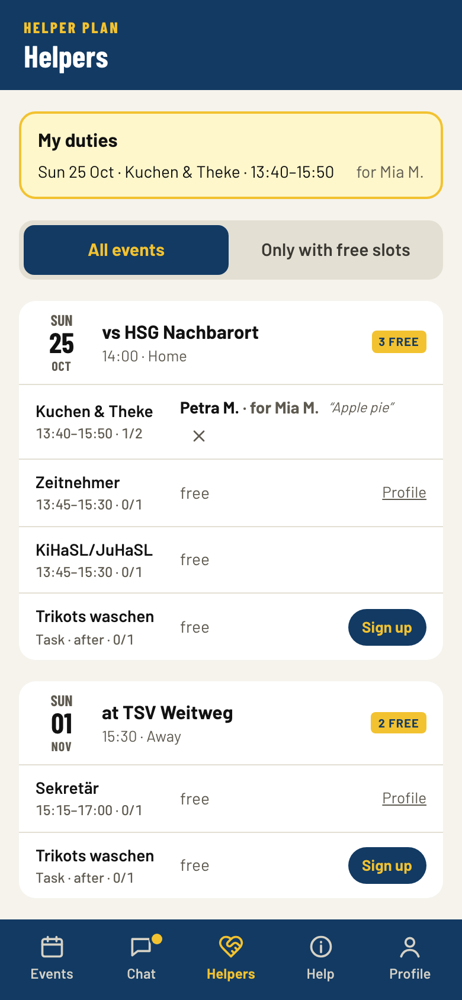
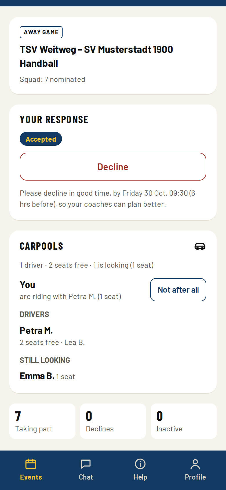

**Deutsch:** [README auf Deutsch](README.md)

# Kabine

Kabine is a free team app for amateur sports clubs: trainings and games with yes/no responses, squad nominations, team chat, push notifications, helper duties and carpools, for players, parents and coaches. It runs as an installable web app on phones and computers, and each club runs its own copy in its own Cloudflare account.

It started as the app of a handball club, where several hundred players, parents and coaches use it every day. Kabine is the same app for any club, in English and German.

<table>
  <tr>
    <td></td>
    <td></td>
    <td></td>
  </tr>
  <tr>
    <td></td>
    <td></td>
    <td></td>
  </tr>
</table>

All pictures show an invented demo club. More in [docs/screenshots](docs/screenshots/en).

## What it does

**Players** see their trainings, games and special events, accept or decline with a tap, and get a notification when something changes. Trainings count as accepted until someone declines, so nobody has to answer every week.

**Parents** respond for their children, read along in the team chat, take on helper duties and offer seats for away games. They decide what their child may do in the app.

**Coaches** set up training plans once a season. The app creates the trainings, skips school holidays and public holidays, and shows who comes. Coaches nominate squads for games, cancel or move trainings with one notification to everyone, invite players and parents by link and see who cannot be reached yet.

**Admins** set up the club with a wizard: language, region, sport, teams, modules, e-mail. They manage teams, coaches and people, and run the season change once a year.

Optional modules: helper duties for home games and events, youth referees, carpools, game schedules from handball4all (German handball), sign-in codes and reminders by SMS. Games can also be imported from a spreadsheet.

## An internal app for one club

Kabine is deliberately not a platform and not in the app stores.

- **One installation per club.** The data stays in the club's own Cloudflare account. There is no central server, no account across clubs, and the authors of Kabine have no access to any club's data.
- **No app store.** People open the club's address and add the app to their home screen. It works like an installed app, with notifications, also on iPhones. Without a store there are no store accounts, no age ratings and no review process between the club and its members, and every update reaches everyone at once.
- **Invitations only.** There is no public sign-up and no public content. Coaches share invitation links in their team's group, admins hand out personal links. Sign-in is by passkey (Face ID, fingerprint, screen lock), so there are no passwords to forget or leak.
- **Small on purpose.** Kabine covers what a team needs week by week. Membership fees, accounting and the club's website stay where they are.

## Privacy and youth protection

Most users are children and teenagers. Of players and parents Kabine stores only first name, last name and the players' year of birth. No address, no date of birth, no phone number unless someone enters one for text messages.

- E-mail address and phone number are **entirely optional** and only used for signing in. Other users, coaches included, never see them. Admins see only other admins' e-mail addresses (required for admins) and, in the full data export, the e-mail addresses of the accounts; phone numbers never.
- Reasons for declining are visible only to coaches and admins and are deleted 60 days after the event.
- Parents of minors decide what their child may do in the app (accept, decline, read and write in the chat) and approve profile pictures before others see them.
- Other parents and players see names shortened ("Kim M.") in helper duties and carpools.
- Team chats always include the coaches, who can mute members and remove messages. There are no private messages.
- No tracking, no advertising, no third-party scripts or fonts. The app loads nothing from other servers.
- Leaving the club removes access at once and all data at the next season change at the latest. Chats, events and responses are deleted every season.

**Cloudflare and where the data lives:** The app runs on Cloudflare's infrastructure (a processor; the club signs Cloudflare's data processing agreement in its own account). The D1 database should be **created explicitly in Europe** (`wrangler d1 create kabine --jurisdiction eu`); the team chat already lives in the EU jurisdiction. The app's code runs at Cloudflare locations near the users, while data is stored in the EU. The "Deploy to Cloudflare" dialog does not guarantee this: if you need it, create the database by hand first ([docs/install.md](docs/install.md)).

The full list of stored data, who sees it and when it is deleted, plus a template for the club's privacy policy: [docs/privacy.md](docs/privacy.md).

## Installation

[](https://deploy.workers.cloudflare.com/?url=https://github.com/witscher/kabine)

You need a Cloudflare account (the free plan is enough for a typical club), a GitHub account and ideally the club's domain. The button creates your copy and all resources; you choose one password for the first admin. Step by step, including e-mail and updates: [docs/install.md](docs/install.md). Running the app (backups, season change, maintenance, updates): [docs/operation.md](docs/operation.md).

## Languages

English and German. Translations are gettext `.po` files in `locales/` that anyone can correct. Adding a language: [docs/translation.md](docs/translation.md).

## Development

Node.js 22 or newer.

```sh
npm ci
npm run secrets:generate -- --dev   # local secrets in .dev.vars
npm run db:reset:local              # local database with the invented demo club
npm run dev                         # http://localhost:5173
npm run check                       # typecheck and tests
npm run e2e                         # end-to-end tests (Playwright)
npm run screenshots                 # the pictures above, in English and German
```

The first admin is set up at `/einrichtung#<ADMIN_BOOTSTRAP_TOKEN>` (see `.dev.vars`).

Built with Cloudflare Workers, D1, Durable Objects and Queues, Hono, Preact and Lingui. Design decisions: [docs/design.md](docs/design.md) and [docs/decisions.md](docs/decisions.md). Security rules with a test each: [docs/security.md](docs/security.md).

## Licence

AGPL-3.0-only, see [LICENSE](LICENSE). You may run, change and share Kabine. If you run a changed version for others, you must offer them its source code.
