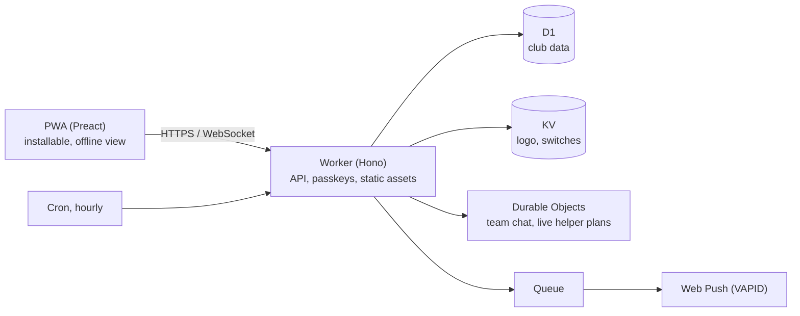

> **Find Kabine useful?** Consider giving the repo a ⭐ to support development.

**Deutsch:** [README auf Deutsch](README.de.md)

# Kabine

**A self-hosted team app for amateur sports clubs that runs entirely on Cloudflare, with no server to run and nothing to pay on the free plan.**

Trainings and games with yes/no responses, squads, team chat, push notifications, helper duties and carpools, for players, parents and coaches. Each club deploys its own copy into its own Cloudflare account with one click.

**Try the demo, no sign-up:** [as a player](https://handball.kabine.dev/api/demo/login/player?lang=en) · [as a parent](https://handball.kabine.dev/api/demo/login/parent?lang=en) · [as a coach](https://handball.kabine.dev/api/demo/login/coach?lang=en) · [as an admin](https://handball.kabine.dev/api/demo/login/admin?lang=en)

[](https://github.com/witscher/kabine/actions/workflows/ci.yml)
[](CHANGELOG.md)
[](LICENSE)
[](https://github.com/witscher/kabine/stargazers)

[](https://deploy.workers.cloudflare.com/?url=https://github.com/witscher/kabine)

<table>
  <tr>
    <td></td>
    <td></td>
    <td></td>
  </tr>
</table>

It started as the app of a handball club, where several hundred players, parents and coaches use it every day. The demo and all pictures show an invented club; more in [docs/screenshots](docs/screenshots/en).

## Quick start

```sh
git clone https://github.com/witscher/kabine && cd kabine
npm ci                              # Node.js 22 or newer
npm run secrets:generate -- --dev   # local secrets in .dev.vars
npm run db:reset:local              # local database with the invented demo club
npm run dev                         # http://localhost:5173
```

The first admin is set up at `/einrichtung#<ADMIN_BOOTSTRAP_TOKEN>` (see `.dev.vars`). `npm run check` runs the typecheck and all tests, `npm run e2e` the Playwright suite.

To run it for a club, use the Deploy button above: it creates the copy and all resources, and the free plan is enough for a typical club. Step by step: [docs/install.md](docs/install.md); running it (backups, season change, updates): [docs/operation.md](docs/operation.md).

## Under the hood



- **Serverless end to end:** Workers with static assets, D1, KV, Durable Objects, Queues and Cron Triggers. No container, no VM, nothing to patch.
- **Real-time chat** on Durable Objects with hibernating WebSockets; helper plans update live the same way.
- **Push without a third party:** Web Push with VAPID, sent from a Queue consumer.
- **No passwords:** sign-in by passkey (WebAuthn); invitations by link; optional e-mail or SMS codes.
- **Installable PWA** that keeps the last loaded state readable offline, also on iPhones.
- **Safe updates for every club:** releases arrive as a pull request in each club's copy; migrations run with a D1 Time Travel restore point and follow expand/contract, each with an upgrade test.
- **Data minimisation by design:** first name, last name and year of birth of players, nothing more by default; no tracking, no third-party scripts or fonts.
- **Tested:** Vitest in the Workers runtime (including contract tests for every module and connector and a test for every [security rule](docs/dev/security.md)), Playwright end-to-end tests and a journey from an empty database through every role.
- **i18n with Lingui:** English and German, gettext `.po` files anyone can correct.

Built with TypeScript, [Hono](https://hono.dev), [Preact](https://preactjs.com) and [Lingui](https://lingui.dev). Architecture: [docs/dev/architecture.md](docs/dev/architecture.md); design and decisions: [docs/dev/design.md](docs/dev/design.md), [docs/dev/decisions.md](docs/dev/decisions.md).

## What clubs get

- **Players** see their trainings, games and events, accept or decline with a tap and get notified of changes. Trainings count as accepted until someone declines.
- **Parents** respond for their children, read along in the team chat, take on helper duties and offer seats for away games. They decide what their child may do in the app.
- **Coaches** set up training plans once a season (school holidays are skipped), nominate squads, cancel or move trainings with one notification, invite players and parents by link and see who cannot be reached yet.
- **Admins** set up the club with a wizard, import teams and people from Excel or CSV lists, and run the season change once a year.

Optional modules: helper duties, youth referees, carpools, game schedules from handball4all (German handball), SMS codes and reminders.

## For clubs and data protection officers

One installation per club, in the club's own Cloudflare account: there is no central server, and the authors of Kabine have no access to any club's data. It is invitation-only, not in the app stores, and stores only what a team needs week by week. The full data inventory, deletion periods and a privacy policy template are in [docs/privacy.md](docs/privacy.md); questions about costs, GDPR and why Cloudflare are answered on [kabine.dev](https://kabine.dev/en/).

## Contributing

The repository is built for contributions made with a coding agent (Claude Code, Codex, Cursor, …): every contribution is a folder or a file of its own, a generator creates the skeleton, and contract tests show at once what is missing. Good places to start:

| Add | Command |
| --- | --- |
| A sport (age groups, playing times, typical helper duties) | `npm run new -- sport basketball --name "Basketball"` |
| Game schedules from an association's system (nuLiga, SAMS, …) | `npm run new -- connector nuliga --vendor "nuLiga" --domain nuliga.example --sport handball` |
| A function clubs can switch on | `npm run new -- module polls --label "Polls" --label-de "Umfragen"` |
| A language or a better translation | [docs/dev/translation.md](docs/dev/translation.md) |

The entry point for people and agents is [AGENTS.md](AGENTS.md). A person sends the pull request, has tried it locally and answers questions. Ideas and requests: [issues](https://github.com/witscher/kabine/issues/new/choose); security problems: [SECURITY.md](SECURITY.md).

## Licence

AGPL-3.0-only, see [LICENSE](LICENSE). You may run, change and share Kabine. If you run a changed version for others, you must offer them its source code.

---

If Kabine is useful to you or your club, a ⭐ helps others find it.
