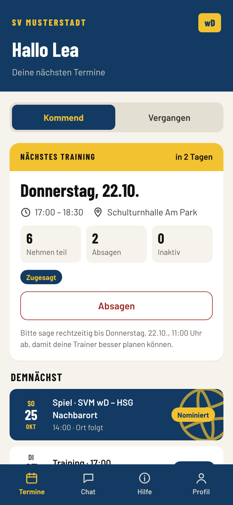
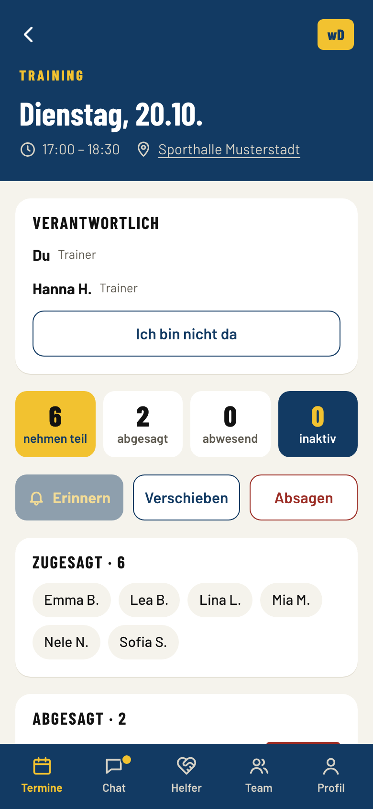
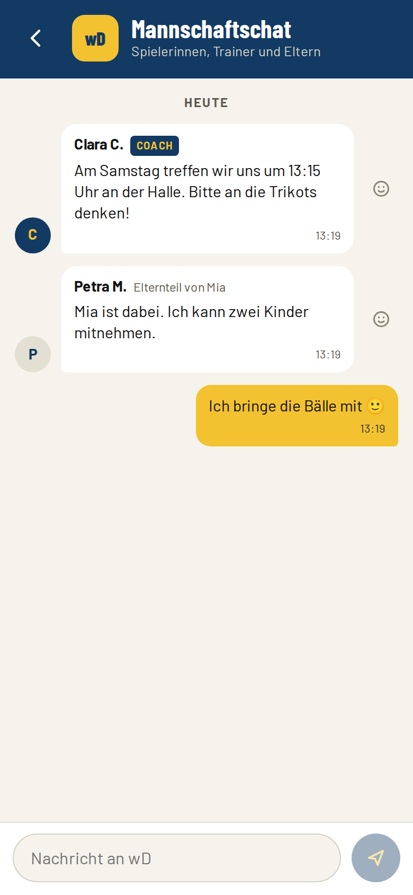
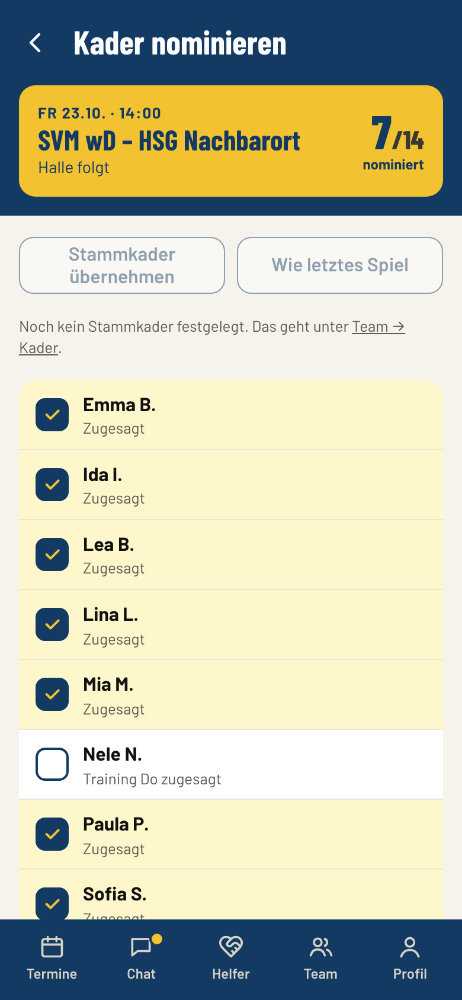
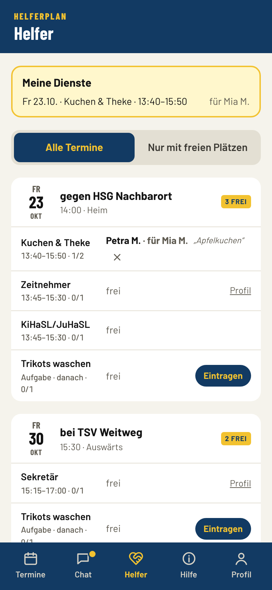
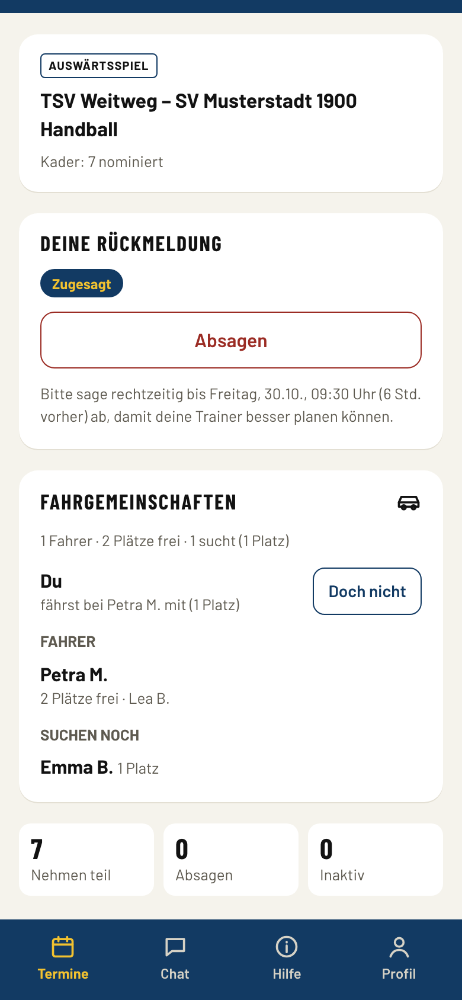

**English:** [README in English](README.en.md)

# Kabine

Kabine ist eine freie Mannschafts-App für Amateursportvereine: Training und Spiele mit Zu- und Absagen, Kadernominierung, Mannschaftschat, Push-Benachrichtigungen, Helferdienste und Fahrgemeinschaften, für Spieler, Eltern und Trainer. Sie läuft als installierbare Web-App auf Handy und Computer, und jeder Verein betreibt seine eigene Installation im eigenen Cloudflare-Konto.

Entstanden ist sie als App eines Handballvereins, in dem sie mehrere hundert Spieler, Eltern und Trainer jeden Tag nutzen. Kabine ist dieselbe App für jeden Verein, auf Deutsch und Englisch.

<table>
  <tr>
    <td></td>
    <td></td>
    <td></td>
  </tr>
  <tr>
    <td></td>
    <td></td>
    <td></td>
  </tr>
</table>

Alle Bilder zeigen einen erfundenen Demo-Verein. Weitere in [docs/screenshots](docs/screenshots/de).

## Was die App kann

**Spieler** sehen ihre Trainings, Spiele und Sondertermine, sagen mit einem Tipp zu oder ab und bekommen eine Benachrichtigung, wenn sich etwas ändert. Trainings gelten als zugesagt, bis jemand absagt. Niemand muss jede Woche antworten.

**Eltern** sagen für ihre Kinder zu und ab, lesen im Mannschaftschat mit, übernehmen Helferdienste und bieten Plätze für Auswärtsspiele an. Sie entscheiden, was ihr Kind in der App darf.

**Trainer** legen einmal pro Saison die Trainingszeiten fest. Die App erzeugt die Trainings, lässt Schulferien und Feiertage aus und zeigt, wer kommt. Trainer nominieren den Kader für Spiele, sagen Trainings ab oder verschieben sie mit einer Benachrichtigung an alle, laden Spieler und Eltern per Link ein und sehen, wer noch nicht erreichbar ist.

**Admins** richten den Verein mit einem Assistenten ein: Sprache, Region, Sportart, Mannschaften, Module, E-Mail. Sie verwalten Mannschaften, Trainer und Personen und machen einmal im Jahr den Saisonwechsel.

Zuschaltbare Module: Helferdienste bei Heimspielen und Veranstaltungen, Kinder- und Jugendschiedsrichter, Fahrgemeinschaften, Spielpläne aus handball4all, Anmeldecodes und Erinnerungen per SMS. Spiele lassen sich auch aus einer Tabelle übernehmen.

## Eine interne App für einen Verein

Kabine ist bewusst keine Plattform und nicht in den App Stores.

- **Eine Installation pro Verein.** Die Daten bleiben im eigenen Cloudflare-Konto des Vereins. Es gibt keinen zentralen Server, kein vereinsübergreifendes Konto, und die Entwickler von Kabine haben keinen Zugriff auf die Daten irgendeines Vereins.
- **Kein App Store.** Man öffnet die Adresse des Vereins und legt die App auf den Startbildschirm. Sie verhält sich wie eine installierte App, mit Benachrichtigungen, auch auf dem iPhone. Ohne Store braucht niemand ein Store-Konto, es gibt keine Altersfreigaben und keine Prüfung zwischen Verein und Mitgliedern, und jedes Update erreicht alle sofort.
- **Nur mit Einladung.** Es gibt keine öffentliche Registrierung und keine öffentlichen Inhalte. Trainer teilen Einladungslinks in der Gruppe ihrer Mannschaft, Admins vergeben persönliche Links. Angemeldet wird mit Passkey (Face ID, Fingerabdruck, Displaysperre), es gibt also keine Passwörter, die man vergessen oder verlieren kann.
- **Absichtlich schlank.** Kabine deckt ab, was eine Mannschaft Woche für Woche braucht. Mitgliedsbeiträge, Buchhaltung und die Website des Vereins bleiben, wo sie sind.

## Datenschutz und Jugendschutz

Die meisten Nutzer sind Kinder und Jugendliche. Von Spielern und Eltern speichert Kabine nur Vorname, Nachname und bei Spielern den Jahrgang. Keine Adresse, kein Geburtsdatum, keine Telefonnummer, außer jemand trägt selbst eine für SMS ein.

- E-Mail-Adresse und Telefonnummer sind **rein optional** und nur für die Anmeldung gedacht. Andere Nutzer, auch Trainer, sehen sie nie. Admins sehen nur die E-Mail-Adresse anderer Admins (für Admins Pflicht) und im vollständigen Datenexport die E-Mail-Adressen der Konten, Telefonnummern nie.
- Absagegründe sehen nur Trainer und Admins. Sie werden 60 Tage nach dem Termin gelöscht.
- Eltern von Minderjährigen legen fest, was ihr Kind in der App darf (zusagen, absagen, im Chat lesen und schreiben), und geben Profilbilder frei, bevor andere sie sehen.
- Andere Eltern und Spieler sehen Namen bei Helferdiensten und Fahrgemeinschaften nur abgekürzt („Kim M.“).
- In jedem Mannschaftschat sind die Trainer dabei. Sie können Mitglieder stummschalten und Nachrichten entfernen. Private Nachrichten gibt es nicht.
- Kein Tracking, keine Werbung, keine fremden Skripte oder Schriften. Die App lädt nichts von anderen Servern.
- Wer den Verein verlässt, verliert den Zugang sofort; alle Daten sind spätestens zum nächsten Saisonwechsel gelöscht. Chats, Termine und Rückmeldungen werden jede Saison gelöscht.

**Cloudflare und Standort der Daten:** Die App läuft auf der Infrastruktur von Cloudflare (Auftragsverarbeiter, der Verein schließt den Auftragsverarbeitungsvertrag im eigenen Konto ab). Die D1-Datenbank sollte **ausdrücklich in Europa angelegt** werden (`wrangler d1 create kabine --jurisdiction eu`), der Mannschaftschat liegt bereits in der EU-Jurisdiktion. Der Code der App läuft an Cloudflare-Standorten in der Nähe der Nutzer, gespeichert wird in der EU. Im „Deploy to Cloudflare“-Dialog gibt es keine Garantie dafür: Wer sie braucht, legt die Datenbank vorher von Hand an ([docs/install.md](docs/install.md)).

Die vollständige Liste der gespeicherten Daten, wer sie sieht und wann sie gelöscht werden, dazu eine Vorlage für die Datenschutzerklärung des Vereins: [docs/privacy.de.md](docs/privacy.de.md).

## Häufige Fragen

Für Vereinsverantwortliche und Datenschutzbeauftragte.

<details>
<summary><b>Was ist Kabine – und was nicht?</b></summary>

Kabine organisiert den Alltag von Mannschaften: Trainings und Spiele mit Zu- und Absagen, Kader, Mannschaftschat, Helferdienste und Fahrgemeinschaften.

Kabine ist **keine Vereinsverwaltung**: keine Mitgliederverwaltung mit Adressen und Eintrittsdaten, keine Beiträge, kein SEPA-Lastschrifteinzug, keine Buchhaltung, keine Vereinswebsite und kein öffentliches Ergebnisportal. Diese Programme bleiben, wo sie sind. Kabine speichert bewusst nur, was eine Mannschaft Woche für Woche braucht.

</details>

<details>
<summary><b>Was kostet Kabine?</b></summary>

Die Software ist kostenlos und frei (AGPL-3.0): keine Lizenz, kein Abo, keine Werbung, für immer.

Für den Betrieb reicht bei einem üblichen Verein mit einigen hundert Mitgliedern der kostenlose Tarif von Cloudflare. Wer mehr Spielraum möchte, nimmt den Bezahltarif (zurzeit 5 US-Dollar im Monat). Kosten pro Nachricht entstehen nur, wenn der Verein das SMS-Modul einschaltet. Eine eigene Domain ist optional.

</details>

<details>
<summary><b>Warum Cloudflare und nicht ein deutsches Hosting?</b></summary>

Wegen Kosten und Verfügbarkeit. Ein eigener Server bei einem Hoster kostet jeden Monat und muss eingerichtet, aktualisiert, gesichert und überwacht werden, im Verein meist von einer ehrenamtlichen Person. Kabine läuft bei Cloudflare ohne eigenen Server im kostenlosen Tarif. Die Plattform spielt Sicherheitsupdates selbst ein, hält auch am Sonntagabend durch, wenn alle gleichzeitig zusagen, und bewahrt eine Historie der Datenbank auf, mit der sich ein Fehler zurückdrehen lässt.

Zum Datenschutz: Der Verein ist Verantwortlicher, Cloudflare ist Auftragsverarbeiter. Der Verein schließt im eigenen Konto den Auftragsverarbeitungsvertrag von Cloudflare ab; er enthält die EU-Standardvertragsklauseln, und Cloudflare ist unter dem EU-US Data Privacy Framework zertifiziert. Die Datenbank sollte ausdrücklich in der EU angelegt werden (`--jurisdiction eu`), der Mannschaftschat liegt bereits in der EU-Jurisdiktion. Anfragen bearbeitet Cloudflare an Standorten in der Nähe der Nutzer, bei Nutzern in Deutschland in der Regel in Europa.

Auf einem eigenen Server läuft Kabine nicht: Die App ist für die Cloudflare-Plattform gebaut (Workers, D1, Durable Objects).

</details>

<details>
<summary><b>Wer hat Zugriff auf unsere Daten?</b></summary>

Nur der Verein. Jede Installation liegt im eigenen Cloudflare-Konto des Vereins. Es gibt keinen zentralen Kabine-Server, und die Entwickler von Kabine haben keinen Zugriff auf die Daten irgendeines Vereins. In der App sieht jede Person nur, was ihre Rolle braucht: Absagegründe zum Beispiel nur Trainer und Admins.

</details>

<details>
<summary><b>Ist Kabine DSGVO-konform?</b></summary>

Kabine ist auf Datensparsamkeit gebaut: Von Spielern und Eltern nur Vorname, Nachname und Jahrgang, kein Tracking, Löschfristen eingebaut. Ob die Verarbeitung im Verein rechtmäßig ist, verantwortet der Verein selbst. Dafür gibt es eine vollständige Liste der gespeicherten Daten (wer sieht was, wann wird es gelöscht) und eine Vorlage für die Datenschutzerklärung: [Datenschutz und Datenverzeichnis](docs/privacy.de.md).

</details>

<details>
<summary><b>Brauchen Kinder ein eigenes Handy oder eine E-Mail-Adresse?</b></summary>

Nein. Eltern sagen für ihre Kinder zu und ab. Kinder mit eigenem Gerät bekommen über einen Link Zugang, ohne E-Mail-Adresse und ohne Telefonnummer. Die Eltern legen fest, was ihr Kind in der App darf, und geben Profilbilder frei.

</details>

<details>
<summary><b>Wie viel Arbeit macht der Betrieb?</b></summary>

Die Installation dauert etwa 30 Minuten. Danach gibt es keinen Server zu pflegen: Updates kommen als Pull Request in die Kopie des Vereins und werden mit einem Klick übernommen, der Saisonwechsel läuft einmal im Jahr mit einem Assistenten, und der Datenexport sichert alles in eine Datei. Trainer verwalten ihre Mannschaften selbst.

</details>

<details>
<summary><b>Was passiert, wenn wir aufhören?</b></summary>

Der Verein exportiert seine Daten und löscht Worker, Datenbank, KV-Speicher und Warteschlange im eigenen Cloudflare-Konto. Dann sind die Daten weg. Es gibt keinen Anbieter, bei dem man kündigen oder eine Löschung beantragen muss.

</details>

<details>
<summary><b>Für welche Sportarten eignet sich Kabine?</b></summary>

Kabine ist in einem Handballverein entstanden und bringt für Handball Altersklassen, Spielzeiten, Helferdienste und die Spielpläne aus handball4all mit. Für Fußball und andere Sportarten gibt es Grundeinstellungen. Weitere Sportarten und Spielplan-Systeme können über GitHub beigesteuert werden.

</details>

<details>
<summary><b>Gibt es Support?</b></summary>

Kabine ist freie Software ohne kommerziellen Support. Fragen, Fehler und Ideen gehören in die Issues auf GitHub. Ausprobieren lässt sich alles vorher in der Demo.

</details>

## Installation

[](https://deploy.workers.cloudflare.com/?url=https://github.com/witscher/kabine)

Nötig sind ein Cloudflare-Konto (der kostenlose Tarif reicht für einen üblichen Verein), ein GitHub-Konto und am besten eine Domain des Vereins. Der Knopf legt die eigene Kopie und alle Ressourcen an; man wählt nur ein Passwort für den ersten Admin. Schritt für Schritt, mit E-Mail und Updates: [docs/install.md](docs/install.md) (Englisch). Betrieb (Datensicherung, Saisonwechsel, Wartung, Updates): [docs/operation.md](docs/operation.md).

## Sprachen

Deutsch und Englisch. Die Übersetzungen liegen als gettext-Dateien (`.po`) in `locales/`, jeder kann sie korrigieren. Eine Sprache hinzufügen: [docs/translation.md](docs/translation.md).

## Entwicklung

Node.js 22 oder neuer.

```sh
npm ci
npm run secrets:generate -- --dev   # lokale Secrets in .dev.vars
npm run db:reset:local              # lokale Datenbank mit dem erfundenen Demo-Verein
npm run dev                         # http://localhost:5173
npm run check                       # Typprüfung und Tests
npm run e2e                         # Ende-zu-Ende-Tests (Playwright)
npm run screenshots                 # die Bilder oben, auf Deutsch und Englisch
```

Der erste Admin richtet sich unter `/einrichtung#<ADMIN_BOOTSTRAP_TOKEN>` ein (siehe `.dev.vars`).

Gebaut mit Cloudflare Workers, D1, Durable Objects und Queues, Hono, Preact und Lingui. Code, Kommentare und die technische Dokumentation sind auf Englisch.

## Mitmachen

Beiträge als Pull Request sind willkommen: Übersetzungen, Sportarten, Anbindungen an Spielplan-Systeme, SMS-Anbieter und eigene Module. Wo was liegt und wie man ein Modul hinzufügt: [docs/modules.md](docs/modules.md) (Englisch), Regeln und Ablauf: [CONTRIBUTING.md](CONTRIBUTING.md).

## Lizenz

AGPL-3.0-only, siehe [LICENSE](LICENSE). Kabine darf genutzt, verändert und weitergegeben werden. Wer eine veränderte Fassung für andere betreibt, muss ihnen den Quellcode anbieten.
